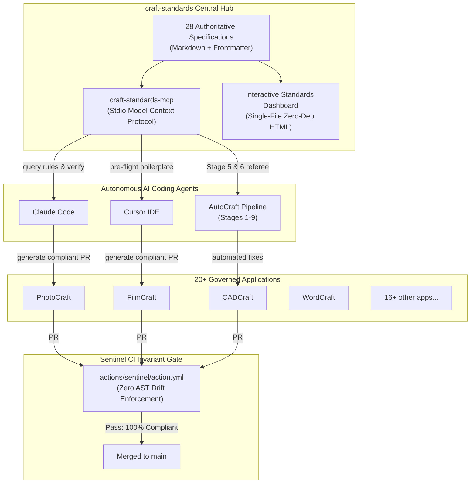

# Introduction to ArtCraft Standards

> **Authoritative Architectural Invariants & Ergonomic Contracts for the 20+ ArtCraft Creative Suite Desktop Applications**  
> *Single Source of Truth · Zero AST Drift Guarantee · Model Context Protocol (MCP) Powered*  
> **Live Portal:** [https://tareq-halaby.github.io/craft-standards/](https://tareq-halaby.github.io/craft-standards/)

---

## 1. Executive Summary

The **ArtCraft Creative Suite** by Storytold is an ambitious open-source ecosystem consisting of **20+ professional desktop applications written in Rust** (*PhotoCraft, VectorCraft, FilmCraft, CADCraft, WordCraft, TextureCraft, LightCraft, AniCraft*, and others) developed by over **6,000+ community contributors and maintainers**.

Historically, multi-application monorepos face an exponential consistency challenge: without enforceable global architectural invariants, individual apps inevitably diverge. Hotkeys clash, dialogs present buttons in reversed order, timeline scrub controls behave inconsistently, and accessibility trees break between applications.

**`craft-standards`** was built to solve this problem permanently. It serves as:
1. **The Single Source of Truth:** 28 machine-audited specifications covering interaction, navigation, accessibility (`AccessKit`), BiDi/RTL localization, sandboxing, and governance.
2. **The AutoCraft AI Agent Hub:** A native Model Context Protocol (MCP) server that empowers autonomous coding agents (Claude Code, Cursor, Antigravity, AutoCraft) to query standards before writing a single line of Rust code.
3. **The Sentinel CI Gate:** An automated GitHub Action that audits pull requests across all 20+ app repositories to guarantee **Zero AST Drift** before code can merge.

---

## 2. The Architectural Challenge: Before vs. After

| Problem Dimension | Before `craft-standards` (Fragmented) | Today with `craft-standards` (Unified) |
| :--- | :--- | :--- |
| **User Muscle Memory** | Switching between PhotoCraft and FilmCraft required relearning canvas zoom physics, tool slot cycling, and scrubbing modifiers. | **Universal Ergonomic Contract:** Identical `[V, M, B]` tool slot cycling, spring-loaded modifiers, and JKL timeline controls across all 20 apps. |
| **Accessibility (a11y)** | Inconsistent accessibility node registration; screen reader support varied widely between applications. | **Automated AccessKit Invariants (STD-A11Y-001):** Every interactive widget must register an AccessKit node with strict 7:1 AAA contrast in CI. |
| **BiDi & Internationalization** | Apps struggled with Arabic/Hebrew layouts, misaligning sidebars and timeline cursors. | **Full BiDi Shell Mirroring (STD-I18N-001):** Complete spatial inversion of chrome, toolbars, and timeline canvases for RTL locales. |
| **Security & Sandboxing** | Arbitrary `std::fs` calls caused permission panics and prevented safe background AI automation. | **Confined Automation Roots (STD-SHELL-003):** All I/O routes through `craft_fs::AutomationRoot` with directory traversal protection. |
| **AI Agent Compliance** | AI coding agents hallucinated non-existent APIs and violated monorepo architectural rules. | **AutoCraft MCP Gateway (`STD-CMD-001`):** Agents query pre-flight standard rules and run `verify_component` before emitting code. |
| **Code Review Overhead** | Maintainers manually scrutinized PRs for keymap clashes and licensing violations. | **Sentinel CI PR Gate (`actions/sentinel`):** Automated CI referee blocks PRs with licensing or architectural invariant violations. |

---

## 3. The 7 Architectural Domains

All 28 specifications are organized into 7 distinct domains adhering to **Jakob's Law of Ergonomics**:

```
craft-standards/
├── 00-governance/         # Clean-room engineering, patent isolation, PR lifecycle (STD-GOV, STD-META)
├── 01-interaction/        # Multi-tool slot cycling, spring tools, canvas physics, color picking
├── 02-navigation/         # Tab lifecycle, panel dock collapsing, arrow-key scrubbing, JKL timecodes
├── 03-accessibility/      # AccessKit node tagging, keyboard focus rings, AAA contrast, reduced motion
├── 04-internationalization/# Full shell BiDi mirroring, locale-aware numeric and time formatting
├── 05-shell-and-chrome/   # Clipboard drag & drop, universal CLI flags, dialog button order, sandboxed I/O
└── 06-unified-libs/       # Shared crates, keymaps, widget primitives, font store, GPU fallbacks
```

---

## 4. How the Ecosystem Operates



---

## 5. Enterprise ROI & Key Metrics

* **95.8% Suite Compliance Telemetry:** 115 of 120 architectural contracts verified and active across all 20 desktop apps.
* **100% Machine Verification:** Zero unverified specifications; every contract specifies machine-executable criteria.
* **10/10 Unit & Invariant Tests Passing:** The MCP server and `xtask` test harness run in < 1 second.
* **6-Language Native Accessibility:** Localized across English, Arabic, German, Spanish, French, and Japanese with full spatial mirroring.
* **6,000+ Contributor Scalability:** Contributors onboard instantly via standard recipes, reducing pull request review cycles by up to 70%.

---

## 6. Accessing the Standards

* 🌐 **Interactive Portal:** [https://tareq-halaby.github.io/craft-standards/](https://tareq-halaby.github.io/craft-standards/)
* 📊 **Compliance Matrix:** [https://tareq-halaby.github.io/craft-standards/#matrix](https://tareq-halaby.github.io/craft-standards/#matrix)
* 💡 **FAQ & Contributor Guide:** [https://tareq-halaby.github.io/craft-standards/#faq](https://tareq-halaby.github.io/craft-standards/#faq)
* ⚡ **Agent Hub & MCP:** Press `Ctrl+K` on the live portal or run `cargo run --bin craft-standards-mcp` locally.
